# Три независимо предложенные схемы — раунд 1

Предложения сохранены до голосования. Их обязательные дефекты не исправлены в этом файле; итоговая схема и повторное голосование фиксируются отдельно.

## Вариант X

```mermaid
flowchart TD
    subgraph DEV["Подготовка и отправка вне исследовательского запуска"]
        D1["Сверить ТЗ и baseline<br/>requirement.txt — источник версий"]
        D2["Собрать ZIP<br/>solution.py и свои модули в корне<br/>Промпты, схемы, настройки — в Python<br/>Перенос: корневые .py и requirements.txt"]
        D3["Проверить целевой Docker и Qwen<br/>Пока образа и ключа нет<br/>Статический аудит не равен запуску"]
        D4["Отправка командой: до 3 в день<br/>Обновление в 00:00 МСК<br/>Ждать предыдущий score, даже нулевой<br/>Private: сохранённый код без изменений"]
        D1 --> D2 --> D3 --> D4
    end

    subgraph RT["Один автономный запуск: только текущая задача"]
        S["solution.py: старт часов до тяжёлых импортов<br/>Общий предел 10800 секунд<br/>argv: путь к task.md, иначе task.md"]
        G["Docker организаторов: Python 3.12<br/>8 CPU, 32 GB; GPU не предполагается<br/>Только установленные пакеты; без MCP<br/>Без pip, Git, загрузок и своего Docker"]
        T["Читать task.md, словарь и CSV<br/>TaskSpec: тип, target, ID, формат<br/>Текст и таблицы; без внешних данных<br/>Метрика и её параметры из задачи"]
        C{"Контракт вывода<br/>разрешён однозначно?"}
        F["Ограниченный разбор противоречий<br/>Затем явная ошибка без обещания CSV<br/>Не подменять задачу догадкой"]
        P["Профиль и фиксированный ValidationSpec<br/>Время, группы или IID; seeds и классы<br/>Преобразования обучаются внутри fit<br/>Confirmation отделить, если возможно"]
        R["Сначала дешёвый форматный резерв<br/>Проверить полный CSV по test и шаблону<br/>Сохранить и атомарно опубликовать<br/>Качество резерва не гарантировано"]
        M{"Точная метрика и<br/>доверенный evaluator доступны?"}
        Q["Адаптер только Qwen3.8-27B<br/>OPENAI_MODEL / API_KEY / BASE_URL<br/>Скрипт передаёт схемы инструментов<br/>Режим ответа и лимиты проверить с ключом"]
        B{"Опыт, проверки и остановка<br/>помещаются с запасом<br/>на финальную запись?"}
        H["Планировщик по журналу опытов<br/>Qwen выбирает действие и аргументы<br/>Draft, debug, признаки, модель, ансамбль<br/>При сбое API — локальный адаптивный план"]
        A["Скрипт разбирает и проверяет action<br/>Типы, разрешённые операции, пакеты<br/>Никаких сторонних pretrained или данных<br/>Лимиты retries, логов и числа повторов"]
        K["Скрипт генерирует Python-программу<br/>Новые формулы из дерева операций<br/>Признаки, обработка и модель с нуля<br/>Произвольный Python не принимается"]
        X["Доверенный trainer исполняет код<br/>Управляет fit и predict по split<br/>Процесс и cwd — не OS sandbox<br/>psutil/watchdog: best effort, без cgroup"]
        E["Доверенный evaluator считает метрику<br/>Проверяет форму и значения предсказаний<br/>Не принимает score из stdout<br/>Сравнение только в одном протоколе"]
        J["Журнал в текущем запуске<br/>Parent, гипотеза, программа, split, score<br/>Время, память, ошибка, timeout, OOM<br/>Результат инструмента вернуть планировщику"]
        V{"Корректный завершённый опыт<br/>лучше текущего лидера?"}
        Y["Подготовить test CSV кандидата<br/>Сохранить отдельный проверенный CSV<br/>Только затем продвигать лидера<br/>Сбой сохраняет прежнего лидера"]
        U["Проверить и атомарно заменить submission.csv<br/>Старый валидный CSV остаётся при ошибке<br/>Рабочий каталог и /tmp; контроль диска<br/>30–35 GB — ориентир, не квота"]
        L["Заморозить shortlist<br/>Рецепты, параметры, пороги, веса<br/>Больше не адаптировать поиск"]
        N["Однократная confirmation при возможности<br/>Ранее не использованные для поиска labels<br/>Иначе выбор по поисковой валидации<br/>Без возврата результата в поиск"]
        W["Выбрать финалиста<br/>Восстановить его готовый CSV<br/>Проверить и атомарно опубликовать<br/>При ошибке оставить валидный резерв"]
        I["Refit необязателен и ограничен временем<br/>Всё разрешённое train; test predict и запись<br/>При сбое оставить готовый CSV<br/>Это не новая независимая оценка"]
        Z["Финальная проверка и завершение процессов<br/>Строки, ID, колонки, классы, конечность<br/>Вероятности — если требует контракт<br/>Любая замена только после проверки"]
        O["submission.csv до принудительной остановки<br/>Рядом с solution.py и task.md<br/>Нет feedback платформы и межзадачной памяти"]

        S --> G --> T --> C
        C -->|Да| P --> R
        C -->|Нет| F
        R -->|Готов| M
        R -->|Невозможно получить допустимый CSV| F
        M -->|Нет: сохранить только резерв| Z
        M -->|Да| Q --> B
        B -->|Да| H --> A
        A -->|Корректно| K --> X --> E --> J --> V
        A -->|Отклонено| J
        X -->|Ошибка, timeout или OOM| J
        V -->|Да| Y
        V -->|Нет| B
        Y -->|CSV готов| U --> B
        Y -->|Сбой подготовки| J
        J -.->|Факты и ошибки для следующего шага| H
        B -->|Нет| L --> N --> W --> I --> Z --> O
        Q -.->|Сбой или режим не подтверждён: локальный план| B
    end
    D4 -->|Платформа запускает отдельно на каждой задаче| S
```

## Вариант Y

```mermaid
flowchart TD
    subgraph DEV["Разработка и внешняя проверка"]
        D1["Один код для public и private<br/>Только разрешённые данные и пакеты<br/>Промпты и схемы внутри корневых .py"]
        D2["Проверка переноса и контрактов<br/>Python 3.12; без mcp и внешних весов<br/>Целевой Docker пока не проверен"]
        D3["ZIP: solution.py, корневые .py<br/>и фиксированный requirements.txt<br/>Без библиотек, вложенных модулей и .whl"]
        D4["Внешняя отправка: до 3 в сутки<br/>Сброс в 00:00 МСК; ждать любой score<br/>Private: сохранённая лучшая public-версия"]
        D1 --> D2 --> D3 --> D4
    end
    subgraph RUN["Один автономный запуск в Docker организаторов"]
        R0["solution.py: старт общих 10800 с<br/>argv: путь task.md или task.md<br/>Каждый запуск без прошлых задач"]
        R1["Супервизор с начала запуска<br/>8 CPU, 32 GB; запас времени и памяти<br/>Потоки, процессы, логи, диск; без GPU"]
        R2["Прочитать task.md и четыре CSV<br/>Тип, target, ID, метрика, формат<br/>Фактический словарь; текст и таблицы"]
        R3{"Выходной контракт<br/>однозначен и поддержан?"}
        R4["Форматный резерв без обучения<br/>Допустимые константные предсказания test<br/>Проверить CSV; качество не гарантировано"]
        R5["Атомарно сохранить ранний submission.csv<br/>Рядом с solution.py и task.md<br/>Сохранить отдельную резервную копию"]
        R6["Фиксированный протокол и профиль fit-части<br/>Время / группы / IID; seeds, классы<br/>Confirmation исключить до первого обучения"]
        R7{"Точная метрика<br/>и evaluator доступны?"}
        R8["Qwen3.8-27B: конфигурация платформы<br/>OPENAI_MODEL / API_KEY / BASE_URL<br/>Проверить формат действий и квоты"]
        R9{"Разрешённый API<br/>и формат работают?"}
        R10{"Новый опыт помещается<br/>с запасом на завершение?"}
        R11["Гипотеза draft / debug / improve<br/>Qwen либо локальный контроллер<br/>Признаки, очистка, модель, ансамбль, split"]
        R12["Скрипт проверяет action и аргументы<br/>Допустимые операции, данные, пакеты<br/>Ошибки и повторы возвращает контроллеру"]
        R13["Компилятор рецепта создаёт Python<br/>Композиция разрешённых операций<br/>Новый протокол: переоценить соперников"]
        R14["Скрипт запускает Python в subprocess<br/>Отдельный cwd; timeout; контроль ресурсов<br/>Это не OS sandbox; cgroup не требуется"]
        R15["Доверенный trainer / evaluator<br/>Сам fit и predict; преобразования по fit<br/>Сам метрика, не число из stdout"]
        R16["Журнал: код, parent, гипотеза, split<br/>Score, ошибки, время, память, артефакты<br/>Компактный результат обратно контроллеру"]
        R17{"Корректный завершённый опыт<br/>продвигается по одному протоколу?"}
        R18["Получить test-предсказания кандидата<br/>Сохранить его CSV отдельно<br/>Проверить колонки, ID, значения, классы"]
        R19{"CSV кандидата валиден<br/>и готов до остановки?"}
        R20["Хранить CSV всех продвинутых кандидатов<br/>Атомарная публикация лидера<br/>Любой сбой оставляет прежний CSV"]
        R21["Заморозить shortlist и все настройки<br/>Больше нет поиска и адаптации"]
        R22["Однократный confirmation, если возможен<br/>Только выбор из замороженного списка<br/>Иначе исходная валидация с оговоркой"]
        R23["Выбрать финалиста с готовым CSV<br/>Без метрики оставить форматный резерв<br/>Сохранить CSV до попытки refit"]
        R24{"Refit + predict + запись<br/>помещаются с запасом?"}
        R25["Опциональный refit разрешённого train<br/>Без новой независимой оценки<br/>Сбой / timeout: прежний CSV"]
        R26["Финальная проверка CSV<br/>Валидный новый файл: atomic replace<br/>Ошибка: откат к сохранённому валидному"]
        R27["submission.csv существует до kill<br/>Остановить дочерние процессы и выйти<br/>Локальные score не равны score платформы"]
        R28["Явный неуспешный запуск<br/>Неразрешимый контракт или нет валидного CSV<br/>Не обещать резерв для любой задачи"]
        R0 --> R1 --> R2 --> R3
        R3 -->|Да| R4 --> R5 --> R6 --> R7
        R3 -->|Нет после сверки материалов| R28
        R4 -->|Невозможно получить валидный CSV| R28
        R7 -->|Да| R8 --> R9
        R7 -->|Нет, без подмены метрики| R23
        R9 -->|Да: схема инструментов модели| R10
        R9 -->|Нет: локальный резерв| R10
        R10 -->|Да| R11 --> R12
        R12 -->|Принято| R13 --> R14 --> R15 --> R16 --> R17
        R12 -->|Отклонено| R16
        R14 -->|Ошибка / timeout / OOM| R16
        R17 -->|Да| R18 --> R19
        R17 -->|Нет| R10
        R19 -->|Да| R20 --> R10
        R19 -->|Нет: оставить прежний| R16
        R16 -.->|Результат инструмента и история| R11
        R10 -->|Нет / лимит / завершение| R21 --> R22 --> R23 --> R24
        R24 -->|Да| R25 --> R26
        R24 -->|Нет| R26
        R26 --> R27
        R1 -.->|Дедлайн / ресурсы, CSV уже есть| R21
        R1 -.->|Авария до первого валидного CSV| R28
    end
    D4 -->|Запускает платформа, без feedback агенту| R0
```

## Вариант Z

```mermaid
flowchart TD
    ZIP["До отправки: проверить ZIP<br/>Только корневые .py и requirements.txt<br/>Промпты и схемы внутри своего кода<br/>Нет библиотек, весов и вложенных модулей"]
    SEND["Внешняя процедура разработки<br/>Не более 3 отправок в день, сброс 00:00 МСК<br/>Ждать любой score предыдущей<br/>Лучший public-код сохраняется для private"]
    START["Организатор запускает solution.py<br/>Сразу t0: дедлайн 10800 секунд<br/>argv: путь task.md, иначе task.md<br/>Чистое состояние одной задачи"]
    ENV["Docker организатора: Python 3.12<br/>8 CPU, 32 GB RAM, без заявленного GPU<br/>Только установленные разрешённые пакеты<br/>Без root, своего Docker, pip, Git, скачиваний"]
    SPEC["Прочитать task.md и текущие CSV<br/>train, test, словарь, sample_submission<br/>Тип, target, ID, метрика и выход<br/>UTF-8; фактическая схема словаря"]
    KNOWN{"Контракт выхода<br/>однозначно восстановлен?"}
    FAIL["Неразрешимый контракт или нет CSV<br/>Зафиксировать неуспех<br/>Универсальный результат не обещать"]
    BASE["Сразу дешёвый форматный резерв<br/>По текущему train и контракту<br/>Проверить строки, ID, типы, значения<br/>Атомарно сохранить submission.csv"]
    PROFILE["Профиль и фиксированный split<br/>Время, группы или IID; seeds и классы<br/>Все обучаемые преобразования только fit<br/>Если можно: отдельный confirmation"]
    EXACT{"Точная метрика и<br/>адаптер задачи поддержаны?"}
    API["Проверить разрешённый Qwen-канал<br/>OPENAI_MODEL, API_KEY, BASE_URL<br/>Ключ пока не выдан; tools / JSON неизвестны<br/>Проверка и запросы входят в срок"]
    MODE{"Подтверждён рабочий<br/>формат действий Qwen?"}
    DEGRADED["Завершить с сохранённым резервом<br/>Без proxy вместо неизвестной метрики<br/>API / задача не поддержаны: ограничение<br/>Успешный AutoResearch не заявлять"]
    BUDGET{"Есть время и ресурсы на опыт<br/>с запасом на CSV и остановку?<br/>Иначе заморозить поиск"}
    PLAN["Qwen: гипотеза и действие с аргументами<br/>draft / debug / improve по дереву опытов<br/>Алгоритм, признаки, обработка, ансамбль<br/>Получает измерения и ошибки скрипта"]
    CHECK["Скрипт проверяет действие и рецепт<br/>Схемы и диспетчер свои, без MCP<br/>Только разрешённые данные и операции<br/>Повторы, сложность, бюджет и зависимости"]
    GEN["Скрипт генерирует исполняемый Python<br/>Из ограниченного рецепта и операторов<br/>Модели и признаки меняются по гипотезе<br/>Произвольный Python модели не исполняется"]
    RUN["Дочерний опыт: свой cwd и процессы<br/>Один опыт; предел потоков, timeout<br/>psutil: память, диск и потомки best effort<br/>Это не OS sandbox, cgroup не требуется"]
    EVAL["Доверенный trainer / evaluator<br/>Сам задаёт fit / predict и считает метрику<br/>Не доверяет score из stdout<br/>Нет test-labels или платформенного feedback"]
    LOG["Журнал дерева опытов<br/>Код, рецепт, parent, split, seeds и версии<br/>Метрика, ошибки, время, RAM и артефакты<br/>После сбоя остановить потомков"]
    BETTER{"Корректный завершённый опыт<br/>лучше на том же протоколе?"}
    TEST["Получить test-предсказания кандидата<br/>Время на predict и CSV включено в бюджет<br/>Сохранить отдельный проверенный CSV<br/>При сбое оставить текущий submission"]
    PROMOTE["Продвигать только с готовым CSV<br/>Атомарная замена submission.csv<br/>Предыдущие лидеры и резерв сохранены<br/>Ошибки публикации ведут к откату"]
    FREEZE["Заморозить shortlist и правила выбора<br/>Рецепты, пороги, веса больше не меняются<br/>Confirmation ранее не обучал и не направлял поиск"]
    CONFIRM["Если хватает данных и времени<br/>Однократно проверить замороженный shortlist<br/>На исключённом confirmation<br/>Иначе выбрать по поисковой валидации"]
    SELECT["Выбрать финалиста и его готовый CSV<br/>Проверить и атомарно восстановить<br/>При ошибке откат к валидному лидеру<br/>Сохранить CSV перед любым refit"]
    REFITQ{"Есть измеренный запас<br/>на полный refit, predict,<br/>проверку и остановку?"}
    REFIT["Необязательный refit с watchdog<br/>На всех разрешённых train-данных<br/>Успех: временный новый CSV<br/>Сбой / timeout: старый CSV остаётся"]
    FINAL["Финальная проверка нового CSV<br/>Колонки, строки, ID, типы, классы / вероятности<br/>Конечность значений и формат sample<br/>Валиден: атомарная замена; иначе откат"]
    OUT["submission.csv существует до kill<br/>Рядом с solution.py и task.md<br/>После refit нет новой независимой оценки<br/>Освободить процессы и завершить вовремя"]
    POLICY["Ресурсы и данные всего запуска<br/>Пишем в cwd / подкаталоги / tmp<br/>30–35 GB: ориентир, проверять остаток<br/>С нуля разрешено; pretrained запрещены<br/>На перенос отдельных весов не рассчитывать"]
    ZIP --> SEND --> START --> ENV --> SPEC --> KNOWN
    KNOWN -->|Нет после сверки| FAIL
    KNOWN -->|Да| BASE
    BASE -->|Не удалось| FAIL
    BASE -->|CSV готов| PROFILE --> EXACT
    EXACT -->|Нет| DEGRADED --> OUT
    EXACT -->|Да| API --> MODE
    MODE -->|Нет или API недоступен| DEGRADED
    MODE -->|Native tools либо проверенный текстовый протокол| BUDGET
    BUDGET -->|Да| PLAN --> CHECK
    CHECK -->|Допустимо| GEN --> RUN
    CHECK -->|Отклонено| LOG
    RUN -->|Успех| EVAL --> LOG
    RUN -->|Ошибка, timeout, OOM| LOG
    LOG --> BETTER
    LOG -.->|Результат действия и история| PLAN
    BETTER -->|Нет| BUDGET
    BETTER -->|Да| TEST
    TEST -->|Валидный CSV| PROMOTE --> BUDGET
    TEST -->|Сбой| LOG
    BUDGET -->|Нет или Qwen исчерпан| FREEZE --> CONFIRM --> SELECT --> REFITQ
    REFITQ -->|Да| REFIT --> FINAL --> OUT
    REFITQ -->|Нет| OUT
    ENV -.-> POLICY
    POLICY -.-> CHECK
```

