# Итог перепроверки схемы и голосования

20 октября 2026 года. Выбрана **Y-v2**: компактный собственный AutoResearch runtime, Qwen для исследовательских решений, проверяемые рецепты с генерацией и исполнением Python, доверенный trainer/evaluator, ранний CSV и безопасная финализация. Установка upstream AIDE не требуется.

**Статус: архитектурная схема ратифицирована; исполнение в Docker организаторов, API Qwen и ML-качество не проверены.** Образ и ключ не предоставлены. Фиксированный список зависимостей принят как установленный по уточнению пользователя, без требования пересогласовать его.

## Независимые варианты и реальные голоса

Три автора с раздельным контекстом сначала прочитали актуальное ТЗ, requirement.txt, baseline.py и предыдущую схему. До фиксации своих предложений чужие варианты не читали. После фиксации SHA256 получили одинаковый обезличенный пакет X/Y/Z. Узнать собственный текст возможно, поэтому процедура не объявляется полностью слепым экспериментом. Предпочтения отражают статическую инженерную оценку, не измеренный выигрыш качества.

| Вариант | Автор | Основное преимущество | Существенный недостаток первоначальной схемы | Первых мест |
|---|---|---|---|---:|
| X | B | Полный переносимый tool-loop и локальный fallback | Профиль перед резервом; неоднозначный обход budget gate; требуется resolver | 0 |
| Y | C | Константный CSV до обучения, ранний supervisor, явный optional refit | Требуются resolver, точные env, устранение обхода gate и ветки без кандидата | 3 |
| Z | A | Хорошо показаны артефакты кандидатов и восстановление выбранного CSV | Резерв по train до отделения confirmation; API-сбой прекращает исследование | 0 |

| Рецензент | Раунд 2: рейтинг | Раунд 3: исправленная Y-v2 | Блокеры |
|---|---|---|---|
| A | Y > X > Z | Принять, независимая проверка | Нет |
| B | Y > X > Z | Принять, независимая проверка | Нет |
| C | Y > X > Z | Принять, авторская самопроверка | Нет |

Исходная Y была выбрана **только как основа**, с обязательными замечаниями. Автор C выпустил отдельную Y-v2; A и B независимо проверили исправление, C записал самопроверку. Голоса первого раунда не выдаются за безусловное принятие неисправленной схемы. Все три бюллетеня последнего раунда содержат один проверенный хеш схемы:

`34C235025C27DBFAF9DF4C3A5D747B98AADF52F48DE8B6EE8EB880AC160068A1`

## Что исправлено

1. Явно учтён перенос только корневых `.py` и `requirements.txt`. Промпты, схемы и настройки находятся в собственном Python-коде; нет зависимости от вложенных модулей или отдельных файлов весов.
2. Убрана зависимость от отсутствующего `mcp`. Скрипт описывает инструменты, принимает и проверяет action/arguments, исполняет действие и возвращает фактический результат Qwen. Baseline сохраняется как контракт argv/env/вывода, его MCP-реализация не переносится без изменений.
3. Исправлены полные имена `OPENAI_MODEL`, `OPENAI_API_KEY`, `OPENAI_BASE_URL`. Native tools и текстовый action-протокол проверяются после получения доступа, а не считаются готовыми.
4. Добавлен ограниченный resolver неизвестного контракта/метрики с успешным возвратом и конечным отказом. Неизвестная метрика не заменяется proxy; исчерпание её resolver ведёт только к форматному резерву и завершению, без неизвестного refit.
5. Супервизор действует с начала solution.py на все этапы и повторные попытки. У журнала нет управляющего перехода в обход проверки ресурсов. Нормальный stop поиска отличается от аварийной остановки; последняя не запускает дорогой confirmation/refit.
6. Первый резерв создаётся без fit и target-статистик. Затем отделяется confirmation, и лишь после этого выполняются обучение и target-зависимый профиль. Изменение search-split требует сопоставимой переоценки кандидатов, confirmation остаётся неизменным.
7. Пустой shortlist ведёт к резерву. Confirmation — однократный условный этап после freeze; refit — отдельная условная ветка с проверкой полного бюджета.
8. Каждый продвигаемый кандидат сначала получает отдельный проверенный test CSV. Выбранный финалист атомарно публикуется до refit. Ошибки записи/предсказания/refit оставляют предыдущий валидный результат, cleanup его не удаляет.

## Сверка обязательных условий

| Условие | Решение в Y-v2 и его границы |
|---|---|
| Docker организаторов; Python 3.12, 8 CPU, 32 GB | Используется существующий контейнер; собственный образ, nested Docker, root, GPU и cgroup write access не требуются. Один активный опыт и ограничение потоков. |
| Три часа с запуска кода | 10800 секунд на импорты, данные, API, fit/predict, проверки, запись и cleanup; общий supervisor и ограниченные retries. |
| Фиксированные зависимости | Источник — полный корневой requirement.txt; тот же список действует для агента, инструментов и сгенерированного кода. Не требуется использовать все установленные AutoML-фреймворки. |
| Только корневые .py и requirements.txt | Собственные модули и встроенные ресурсы; никаких обязательных внешних конфигов, библиотек, .whl, весов или вложенных модулей. Runtime-файлы создавать можно. |
| MCP отсутствует | Прямой диспетчер инструментов в скрипте; неизменённый baseline с верхнеуровневым import mcp несовместим с данным окружением. |
| Только Qwen3.8-27B | Разрешённый канал организаторов и точные OPENAI_*; режим/квоты условны до проверки. Локальный fallback честно отмечен как деградация LLM. |
| Нет общего интернета | Нет runtime pip/Git, внешних данных или скачивания моделей. Разрешённый Qwen API — предусмотренное исключение. |
| 600 рублей | Только сутки разработки; не бюджет задачи на платформе и не доказательство отсутствия API-квот. |
| Модели и данные | Только данные кейса и допустимые пакеты; сторонние pretrained запрещены. Свои модели с нуля разрешены, основной путь обучает их в runtime. Передача заранее подготовленных собственных весов не предполагается. |
| Public/private и независимые задачи | Один код; чистое состояние на задачу. Target, тип, метрика и формат определяются заново, без жёсткой привязки к public. |
| Реальный AutoResearch | Гипотезы по журналу draft/debug/improve; новые композиции признаков, обработки, моделей и ансамблей; компиляция и исполнение Python. Не только фиксированный HPO. |
| Достоверная оценка | Trainer владеет fit/predict и split; evaluator вычисляет точную метрику. Число из stdout и скрытый score не используются как доказательство улучшения. |
| Валидация | Fit-зависимые преобразования внутри fit; общий протокол сравнения; отдельный confirmation при возможности, один раз после freeze, без возврата в поиск. |
| Процессы и память | psutil/watchdog/process tree best effort. cwd и один UID не обеспечивают OS sandbox; произвольный Python модели не принимается. |
| Итоговый файл | Ранний резерв, отдельный CSV каждого продвинутого кандидата, проверка формы/ID/значений/классов, atomic replace на той же ФС, откат. Формат не гарантирует ненулевой score. |
| Финальное обучение | Необязательный refit после публикации выбранного CSV, только при измеренном запасе на весь путь. После него нет новой независимой оценки на использованных labels. |
| Диск и запись | cwd, подкаталоги и /tmp. 30–35 ГБ — ориентир свободного места, не квота; фактический остаток контролируется. |
| Типы данных | Только текст/таблицы; текущие task.md, train/test, фактический словарь и sample. Поле unit и фиксированные public-targets не предполагаются. |
| Метрики | Public: RMSE вниз, MacroF1 вверх; private определяется из задания. Точные параметры MacroF1 требуют проверки; B_RMSE/B_F1 не выдумываются. Локальная метрика не является score платформы. |
| Контракт baseline | Позиционный путь task.md, default task.md, OPENAI_MODEL/OPENAI_API_KEY/OPENAI_BASE_URL; submission.csv рядом с solution.py и task.md. |
| Отправки | Внешняя процедура: до 3 в день на команду, сброс 00:00 МСК, ждать предыдущий score, включая ноль. Private — сохранённый лучший public-код. Tie-break равных score уточняется при необходимости. |

Полная семантика каждого узла «Шаг» — обязательный supervisor wrapper, а не рекомендация. Она включает вложенные API-запросы, retries, resolver, repair, тяжёлые импорты, fit/predict и публикацию. Это требование к будущей реализации. Глобальная аварийная ветка допускает лишь сохранение/откат и ограниченный cleanup. Подробности и таблица 14 границ: [revision-y-v2.md](revision-y-v2.md). Независимая сверка модератора: [moderator-final-audit.md](moderator-final-audit.md).

## Проверка результата и оставшиеся внешние проверки

Проверены целостность исходников/зафиксированных предложений, JSON бюллетеней и совпадение их reviewed_sha256. Базовая структурная проверка Mermaid: 35 узлов, 35 строк связей, необъявленных узлов нет. Это не полноценный parser/render test.

После получения доступа нужны реальные проверки копирования ZIP, выбранных импортов в целевом Python 3.12, argv/env/CSV, Qwen-протокола и квот; ранней записи и отката; timeout/OOM/API-ошибок/отказа диска и cleanup. Также нужны замеры запасов времени/памяти и ML-качества на public. Схема не обещает поддержку любого произвольного private-контракта: невозможность разрешить его должна быть явной.

Исходные документы и требование пользователя не менялись. Продуктовый код не реализовывался и не изменялся.

## Артефакты

- [Все три исходных схемы](alternatives.md), [правила голосования](protocol.md).
- [Пакет кандидатов](candidates.json), [mapping](label-map.json), [фиксация исходников](source-locks.json), [фиксация предложений](proposal-locks.json).
- [Раунд 2](round2-results.json): [A](ballot-a.json), [B](ballot-b.json), [C](ballot-c.json).
- [Повторная ратификация](selected.json): [A](ballot-a-round3.json), [B](ballot-b-round3.json), [C](ballot-c-round3.json).
- [Итоговая точная схема](selected-scheme.mmd), [обоснование редакции](revision-y-v2.md).

## Выбранная схема Y-v2

```mermaid
flowchart TD
    subgraph DEV["Подготовка и отправка вне запуска"]
        D1["ZIP: solution.py, корневые .py<br/>и фиксированный requirements.txt<br/>Промпты, схемы и настройки внутри Python<br/>Без библиотек, .whl и вложенных модулей"]
        D2["Проверить перенос и контракт baseline<br/>Только установленные пакеты, без MCP<br/>Образ Docker и ключ Qwen пока не получены<br/>Статический аудит не равен smoke-запуску"]
        D3["До 3 отправок в сутки команды<br/>Сброс 00:00 МСК; ждать score, включая ноль<br/>Private: сохранённый лучший public-код<br/>Без изменений и feedback внутри запуска"]
        D1 --> D2 --> D3
    end
    subgraph RT["Одна задача в Docker организаторов"]
        S["solution.py: t0 и супервизор до импортов<br/>Общий предел 10800 с; argv: task.md или путь<br/>Python 3.12, 8 CPU, 32 GB; один опыт<br/>Без GPU, root, своего или nested Docker"]
        G["Инвариант каждого узла «Шаг»<br/>Перед КАЖДЫМ вызовом: время, CPU, RAM, диск<br/>Timeout и bounded retry внутри остатка<br/>Запас на CSV и cleanup; cgroup не требуется"]
        SPEC["Шаг: текущие task.md и четыре CSV<br/>Тип, target, ID, формат, точная метрика<br/>Фактический словарь; текст и таблицы<br/>Без target-статистик до разделения"]
        C{"Выходной контракт<br/>однозначен и поддержан?"}
        RESOLVE["Шаг: ограниченный resolver<br/>Только текущие файлы; лимит попыток/времени<br/>Контракт либо точная метрика/адаптер<br/>Доверенный реестр/формулы; без proxy"]
        BASE["Шаг: константный форматный резерв<br/>Без fit и target-статистик train<br/>Константа из контракта/sample, не confirmation<br/>Проверить полный test CSV; score не обещать"]
        PUB["Шаг: первая атомарная публикация<br/>Проверенный temporary на той же ФС<br/>submission.csv рядом с solution.py/task.md<br/>Копия резерва; ошибка записи: bounded retry"]
        SPLIT["Шаг: сначала отделить confirmation<br/>Затем split поиска и профиль fit-части<br/>Время / группы / IID; seeds, классы<br/>Confirmation неизменен при смене split"]
        M{"Точная метрика и<br/>доверенный evaluator доступны?"}
        API["Шаг: проверить только Qwen3.8-27B<br/>OPENAI_MODEL / OPENAI_API_KEY<br/>OPENAI_BASE_URL; квоты и формат ответа<br/>Скрипт передаёт описания и схемы tools"]
        MODE{"Проверен native tools<br/>либо валидированный<br/>текстовый action-протокол?"}
        B{"Следующий шаг поиска помещается<br/>с запасом на завершение?<br/>Проверка повторяется внутри каждого «Шага»"}
        PLAN["Шаг: action и аргументы по журналу<br/>Qwen: draft / debug / improve<br/>Признаки, очистка, модели, ансамбли, split<br/>Local controller — явная деградация LLM"]
        CHECK["Шаг: скрипт проверяет action/аргументы<br/>Разрешённые данные, операции, пакеты<br/>Сложность, повторы, repair и квоты<br/>Модель сама инструмент не исполняет"]
        GEN["Шаг: компилятор создаёт Python<br/>Из проверенных исследовательских операций<br/>Новый split: переоценить соперников<br/>Не принимать произвольный Python модели"]
        RUN["Шаг: скрипт исполняет Python<br/>subprocess, cwd, потоки, timeout<br/>psutil и потомки — best effort<br/>Это не OS sandbox; один UID не защищает labels"]
        EVAL["Шаг: доверенный trainer / evaluator<br/>Сам управляет fit/predict по split<br/>Преобразования только по fit; сам метрика<br/>Не принимает score из stdout"]
        LOG["Шаг: обновить журнал и состояние<br/>Код, parent, гипотеза, split, score, ошибки<br/>Время, память, CSV; результат для модели<br/>Сам журнал не вызывает планировщик"]
        BETTER{"Завершённый корректный опыт<br/>продвигается по общему протоколу?"}
        TEST["Шаг: test predict и проверенный CSV<br/>Строки, ID, колонки, типы, конечность<br/>Классы / вероятности по контракту<br/>Сохранить CSV до продвижения кандидата"]
        PROMOTE["Шаг: продвинуть с готовым CSV<br/>Атомарно опубликовать лидера<br/>Хранить CSV всех продвинутых кандидатов<br/>Сбой записи: прежний валидный файл"]
        FREEZE{"Заморозить shortlist и настройки<br/>Есть оценённый кандидат<br/>с готовым CSV и точной метрикой?"}
        CONFQ{"Confirmation выделен и ещё не использован,<br/>есть данные и запас на всю проверку<br/>с последующим выбором и cleanup?"}
        CONF["Шаг: один confirmation замороженного списка<br/>Ранее не использован для обучения/поиска<br/>Только выбор фиксированных кандидатов<br/>Без возврата в адаптивный поиск"]
        SELECT["Шаг: выбрать финалиста с готовым CSV<br/>Проверить и атомарно опубликовать его CSV<br/>Сохранить копию до любого refit<br/>Сбой: откат к последнему валидному"]
        REFITQ{"Есть выбранный обучаемый рецепт<br/>и запас на refit, predict, проверку,<br/>публикацию и остановку?"}
        REFIT["Шаг: необязательный refit разрешённого train<br/>Новый временный CSV; watchdog<br/>Сбой / timeout: выбранный CSV остаётся<br/>Новой независимой оценки нет"]
        FINAL["Шаг: ограниченная финальная проверка<br/>Новый валидный CSV: atomic replace<br/>Иначе оставить сохранённый валидный<br/>Без метрики/кандидатов — только резерв"]
        CLEAN["Шаг: bounded cleanup и остановка потомков<br/>CSV и резерв не удалять<br/>Ошибка cleanup не отменяет готовый CSV<br/>Без новых fit, API и полной переоценки"]
        OUT["submission.csv существует до kill<br/>Рядом с solution.py и task.md<br/>Завершить до общего дедлайна<br/>Локальная метрика не score платформы"]
        FAIL["Явный неуспех: валидного CSV нет<br/>Контракт не разрешён / retry исчерпаны<br/>Bounded cleanup без обещания результата"]
        ERR{"Глобальный handler любого «Шага»<br/>Мягкая остановка / авария / retry исчерпаны<br/>Остановить активные работы; rollback<br/>Есть ранее проверенный валидный CSV?"}
        S --> SPEC --> C
        S -.->|Обязателен для каждого «Шага», включая API и retry| G
        G -.->|Глобальное прерывание любого этапа| ERR
        C -->|Да| BASE --> PUB --> SPLIT --> M
        C -->|Нет, попытки ещё есть| RESOLVE
        RESOLVE -->|Контракт разрешён| C
        RESOLVE -->|Точная метрика разрешена| M
        RESOLVE -->|Контракт не разрешён, лимит исчерпан| FAIL
        RESOLVE -->|Метрика не разрешена, лимит исчерпан| FINAL
        BASE -->|Невозможен допустимый резерв| FAIL
        M -->|Нет, попытки ещё есть| RESOLVE
        M -->|Да| API --> MODE
        MODE -->|Да: зафиксировать режим Qwen| B
        MODE -->|Нет: зафиксировать local-деградацию| B
        B -->|Да| PLAN --> CHECK
        CHECK -->|Принято| GEN --> RUN --> EVAL --> LOG --> BETTER
        CHECK -->|Отклонено / repair нужен| LOG
        RUN -->|Ошибка / timeout / OOM опыта| LOG
        BETTER -->|Да| TEST
        BETTER -->|Нет| B
        TEST -->|CSV готов| PROMOTE --> B
        TEST -->|Сбой: старый CSV остаётся| LOG
        B -->|Нет / остановить поиск| FREEZE
        FREEZE -->|Да| CONFQ
        FREEZE -->|Нет: резерв, без confirmation/refit| FINAL
        CONFQ -->|Да| CONF --> SELECT
        CONFQ -->|Нет: выбор по search-validation| SELECT
        SELECT --> REFITQ
        REFITQ -->|Да| REFIT --> FINAL
        REFITQ -->|Нет| FINAL
        FINAL --> CLEAN --> OUT
        ERR -->|Да: сохранить CSV, только cleanup| CLEAN
        ERR -->|Нет: до первой публикации| FAIL
    end
    D3 -->|Платформа: новый автономный запуск| S

```

